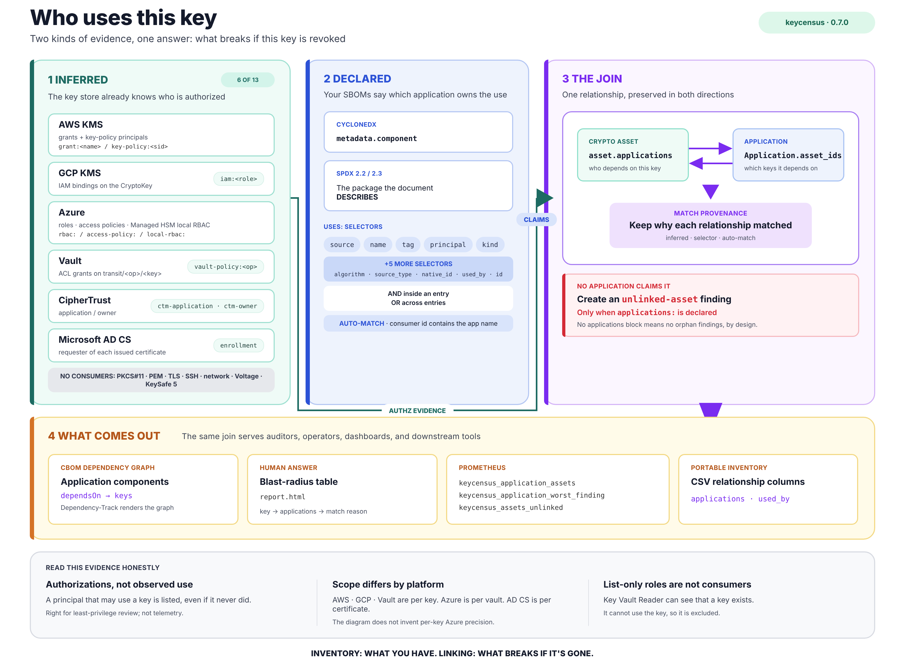

# keycensus

**A census of every cryptographic key, certificate and TLS endpoint you own — and what's wrong with them.**

One command scans your HSMs (PKCS#11, CipherTrust Manager, KeySafe 5), Vault, AWS KMS, Azure Key Vault /
Managed HSM, Google Cloud KMS (one account, or every account, subscription and project in your organization),
Voltage, Microsoft AD CS, certificate folders, TLS and SSH endpoints and whole network ranges, and grades every
asset against
**PCI DSS v4.0**, **NIST SP 800-57 / 800-131A** and the **NIST IR 8547** post-quantum timeline.

It answers three questions, not one: **what do we have** — a standards-based CBOM (CycloneDX 1.6), an HTML
report a human can read, Prometheus metrics. **What just got worse** — every rescan is diffed and classified,
so a key that became exportable pages someone instead of waiting for an audit. **What breaks if this key is
revoked** — your SBOMs joined to the keys each application actually uses.




[](https://github.com/FlavioImbertDomingos/keycensus/actions/workflows/ci.yml)
[](LICENSE)
[](docs/CBOM.md)

---

## Non-technical explanation

Imagine your school has hundreds of lockers, and every locker has a key. Some keys are in the
office safe, some are with teachers, some are taped under desks. Some locks are the good new kind,
some are the flimsy kind from 1995 that open with a paperclip. And nobody has a list.

**keycensus walks around, finds every key, and writes the list.** For each one it notes:
*what kind of lock it opens, how strong the lock is, how old the key is, where it's kept,
and whether it's the paperclip kind.* Then it hands you two things:

1. A **report** with the problems at the top — "this lock is the paperclip kind", "this key is
   8 years old", "this door pass expires next Tuesday".
2. The **list itself in a standard format** (a *CBOM*), so auditors and other tools can read it
   without asking you.

Why now? Two reasons. **PCI DSS 4.0** now *requires* the list (requirement 12.3.3, mandatory since
March 2025). And **quantum computers** will eventually open a whole category of today's locks
(RSA and elliptic-curve). NIST's final transition plan (IR 8547, October 2026) says those locks are
deprecated after 2030 and not allowed after 2035, and a US executive order gives federal systems until
2030 and 2031. You can't replace what you haven't counted. The dates and sources are in
[docs/PQC-TIMELINE.md](docs/PQC-TIMELINE.md).

---

## Try it in 3 minutes (no HSM, no AWS account, no Voltage licence)

Needs [Docker Desktop](https://www.docker.com/products/docker-desktop/) or Docker Engine + compose.

```bash
git clone https://github.com/FlavioImbertDomingos/keycensus.git
cd keycensus
docker compose up -d
```

Give it ~60 seconds (Vault boots, gets seeded, a SoftHSM token is created, a fake KMS is populated),
then open **http://localhost:9742/report.html**.

| What | Where |
|---|---|
| HTML report | http://localhost:9742/report.html |
| CBOM (CycloneDX 1.6) | http://localhost:9742/cbom.json |
| Raw inventory | http://localhost:9742/inventory.json |
| Prometheus metrics | http://localhost:9742/metrics |
| Vault UI (token `root`) | http://localhost:8200 |

Want charts and alerts too? `docker compose --profile monitoring up -d` adds Prometheus and Grafana
(http://localhost:3000, admin/admin) with a pre-built dashboard.

### What the demo scans

Nothing is faked in the *code path* — only the *backends* are stand-ins:

| Source in demo | What it really is | Findings you'll see |
|---|---|---|
| `softhsm` | A real PKCS#11 token (SoftHSM) inside the container, seeded with 8 keys | 3DES key, RSA-1024, an extractable KEK, quantum-vulnerable RSA/EC |
| `vault` | A **real HashiCorp Vault** dev server with Transit keys + a PKI mount | exportable key, rotation off, short-lived cert, AES-128 |
| `fake-aws` | moto — an AWS API mock so faithful that real `boto3` doesn't notice | rotation disabled, disabled key, quantum-vulnerable signing keys |
| `voltage` | A mock inventory export in the canonical Voltage shape | rotation overdue (800 days), 3DES, software-only keys |
| `app-certs` | A folder of deliberately imperfect PEM files | expired cert, expiring-in-10-days, RSA-1024, orphan private key |
| `edges` | The mock's HTTPS port, scanned like any TLS endpoint | self-signed, expiring cert, classical key exchange (no X25519MLKEM768) |
| *applications* | Two CycloneDX SBOMs (`demo/sboms/`) plus a declared app, linked to the keys above via selectors, KMS grants and Vault policies | the Applications table, `unlinked-asset` findings for orphan keys |

### What the output looks like

```
$ docker compose exec keycensus keycensus scan -c /config/keycensus.yml -o /out

assets:   45  (key=36, certificate=8, protocol=1)
sources:  6/6 ok
  - softhsm (pkcs11): 12 assets
  - vault (vault): 10 assets
  - fake-aws (aws-kms): 7 assets
  - voltage (voltage): 7 assets
  - app-certs (pem): 8 assets
  - edges (tls): 2 assets
findings: critical=1, high=5, medium=15, low=25, info=19

  [critical] legacy.batch — Certificate has EXPIRED
  [high    ] old.reporting — RSA-1024 is below the strong-cryptography minimum
  [high    ] legacy-pin-3des — 3DES is a broken or deprecated algorithm
  [high    ] batch-3des — 3DES is a broken or deprecated algorithm
  [medium  ] pan-fpe-legacy — Key is 800 days old, cryptoperiod is 365 days
  [medium  ] gateway.payments — Certificate expires in 10 days
  ...
```

Every finding says **what**, **why it matters**, **what to do**, and **which control** it maps to
(`PCI-DSS-4.0:3.7.4`, `NIST-IR-8547`, ...).

---

## Point it at your real estate

```bash
cp config/keycensus.example.yml config/keycensus.yml     # describe your sources
cp .env.example .env                                     # secrets go here, never in YAML
pip install "keycensus[all]"                             # or use the container
keycensus scan -c config/keycensus.yml -o ./out
```

```yaml
# config/keycensus.yml
policy: default
sources:
  - name: luna-payments
    type: pkcs11
    module: /usr/safenet/lunaclient/lib/libCryptoki2_64.so
    token_label: payments-partition
    pin_env: LUNA_PIN_PAYMENTS
    hardware_backed: true
    fips_validated: true
  - name: vault-prod
    type: vault
    url: https://vault.example.com:8200
    token_env: VAULT_TOKEN
  - name: aws-org                 # every account in the AWS Organization, every enabled region
    type: aws-kms
    organization: true
    regions: all
  - name: azure-all               # every Key Vault and Managed HSM in every subscription
    type: azure-keyvault
    discover: true
  - name: gcp-all                 # every project you can see
    type: gcp-kms
    discover: true
  - name: ctm-prod
    type: ciphertrust
    url: https://ctm.example.com
    username: keycensus
    password_env: CTM_PASSWORD
  - name: voltage
    type: voltage
    file: /exports/voltage-keys.csv
  - name: corp-pki
    type: adcs
    ldap_url: ldaps://dc01.corp.example.com
    username: svc-keycensus@corp.example.com
    password_env: ADCS_LDAP_PASSWORD
    exports: [/exports/corp-issuing-ca1.csv]
  - name: app-certs
    type: pem
    paths: [/etc/ssl/app]
  - name: edges
    type: tls
    endpoints: ["api.example.com:443"]
  - name: dc-east                 # find TLS, LDAPS and SSH endpoints nobody listed
    type: network
    cidrs: [10.20.0.0/22]

# Optional: join your SBOMs to the keys each application uses (see below).
applications:
  - sbom: sboms/payments-api.cdx.json      # CycloneDX or SPDX 2.2/2.3 JSON
    owner: payments-team
    uses:
      - {source: luna-payments, name: "pan-*"}
      - {principal: "arn:aws:iam::*:role/payments-api*"}
```

Then either run it on a schedule (`keycensus scan ... --fail-on high` in CI / cron) or leave it
running (`keycensus serve -c ... --interval 6h`) and point Prometheus at `:9742/metrics`.

**Read-only, always.** Every collector uses list/describe/read calls only. The PKCS#11 collector
never reads key values, only public attributes. Least-privilege policies for every source are in
[`deploy/`](deploy/README.md) and [docs/PERMISSIONS.md](docs/PERMISSIONS.md).

**Safe to leave running.** `serve` needs a token or a sign-in through your identity provider (OIDC)
for the report and CBOM, can serve HTTPS, and with `audit:` and `signing:` keeps a hash-chained log of
who read what and signs every scan, with an RFC 3161 timestamp, so an assessor can verify it was not
changed and when it existed. Credentials can come from Vault, AWS Secrets Manager, Azure Key Vault or
GCP Secret Manager. See [SECURITY.md](SECURITY.md).

---

## What it checks

| Rule | Default | Control |
|---|---|---|
| Broken / deprecated algorithm (DES, 3DES, RC4) | high | PCI 3.5.1, 3.7.5; NIST 800-131A |
| Key size below "strong cryptography" (RSA<2048, ECC<224, AES<128) | high | PCI 3.7.1 |
| Certificate signed with SHA-1 / MD5 | high | PCI 4.2.1 |
| Key older than its cryptoperiod | medium | PCI 3.7.4; NIST 800-57 |
| Automatic rotation available but off | low | PCI 3.7.4 |
| Certificate expired / expiring (7d, 30d) | critical / high / medium | PCI 4.2.1 |
| Key exportable / extractable | medium | PCI 3.7.3, 3.6.1 |
| Key in software, not an HSM | low | PCI 3.6.1; FIPS 140-3 |
| Quantum-vulnerable **encryption** key (harvest-now-decrypt-later) | medium | NIST IR 8547; EO 14412; PCI 12.3.3 |
| Quantum-vulnerable signing key | low | NIST IR 8547; EO 14412; PCI 12.3.3 |
| AES-128 / AES-192 (margin note; NIST keeps both) | info | none |
| TLS < 1.2 accepted, weak cipher suite, no forward secrecy | high / high / low | PCI 4.2.1, 12.3.3 |
| TLS 1.3 / SSH key exchange is classical (x25519, P-256, curve25519-sha256) | medium | NIST IR 8547; EO 14412; PCI 12.3.3 |
| TLS 1.3 / SSH key exchange is hybrid (X25519MLKEM768, mlkem768x25519-sha256): allowed, but temporary | info | NIST IR 8547 |
| SSH server offers SHA-1, DSA, CBC, RC4, 3DES or MD5 algorithms | high | NIST 800-131A; PCI 12.3.3 |
| No creation date (cryptoperiod unknowable) | info | PCI 12.3.3, 3.6.1.1 |
| AD CS CA publishes a template that allows weak keys | medium | PCI 3.7.1; NIST 800-131A |

All thresholds and severities live in one YAML: [`keycensus/data/default-policy.yml`](keycensus/data/default-policy.yml).
Copy it, change the numbers, pass `--policy`. Full list: [docs/POLICY.md](docs/POLICY.md).

---

## Outputs

| Format | For | Notes |
|---|---|---|
| `cbom.json` | Auditors, Dependency-Track, PQC migration tools | CycloneDX 1.6, `cryptographic-asset` components; findings as `vulnerabilities`; **schema-validated in CI** |
| `report.html` | Humans | Self-contained, printable, filterable |
| `inventory.json` | Scripts | Everything, including raw source fields |
| `inventory.csv` | Spreadsheets, GRC uploads | One row per asset with findings column |
| `/metrics` | Prometheus | Findings by severity/rule/source, key age, cert expiry, quantum class, **and change counters** |
| `diff.json` / `diff.md` | Change review, CI gates | With `--baseline previous/inventory.json`: assets added / removed / changed, findings new / resolved, sources broken |
| `changes.json` | Alerting | Each change classified into a kind with an urgency: what should page, what waits for the weekly digest |
| `manifest.json` + `.sig` (+ `.tsr`) | Assessors, evidence | With `signing:`: the SHA-256 of every output, an Ed25519 signature over them, and with `signing.timestamp` an RFC 3161 timestamp on the signature; `keycensus verify` checks it |
| `audit.jsonl` | Security, assessors | With `audit:`: every scan, config change, report read (by token name), refused request and webhook, hash-chained |
| Applications (in all of the above) | Incident response, ownership | `applications:` + SBOMs → which app uses which key; CBOM gets `application` components with `dependsOn` → keys; `unlinked-asset` findings for orphans |

```bash
keycensus scan -c keycensus.yml -o out --baseline last/inventory.json --fail-on-new high   # exit 3 on new high+ findings
keycensus scan -c keycensus.yml -o out --baseline last/inventory.json --fail-on-page       # exit 5 if the estate got worse
keycensus keygen --out keycensus-signing && keycensus verify out --public-key keycensus-signing.pub.pem   # signed scans
keycensus audit verify /var/log/keycensus/audit.jsonl                                       # check the audit chain
keycensus diff last/inventory.json out/inventory.json -f markdown                           # or text / json
keycensus link -c keycensus.yml -i out/inventory.json --sbom sboms/payments-api.cdx.json -o out   # SBOM ↔ CBOM
keycensus upload dtrack --url https://dtrack.corp --project hsm-estate --version 2026-09-02 --cbom out/cbom.json
helm install keycensus ./helm/keycensus -f my-values.yaml                                    # Deployment and/or CronJob
```

---

## Add a source

A collector is one Python class:

```python
class MyKmsCollector(Collector):
    type_name = "my-kms"
    def collect(self) -> list[CryptoAsset]:
        return [self.asset(kind="key", name="...", native_id="...", algorithm="AES", key_size=256, ...)]
```

Register it in `keycensus/collectors/__init__.py`, done. Entrust nShield, Utimaco, YubiHSM and
CloudHSM already work through the PKCS#11 collector. [docs/ARCHITECTURE.md](docs/ARCHITECTURE.md)
has the walkthrough.

---

## Who uses this key

The question an incident actually starts with is not *is this key weak* — it is *if I revoke this key right
now, what stops working?* keycensus answers it from two kinds of evidence.

**Inferred**, from the key store itself: AWS KMS grants and key-policy principals, GCP IAM bindings, Azure
role assignments and access policies, Vault ACL policies granting `transit/<op>/<key>`, CipherTrust
application and owner, the account that enrolled for an AD CS certificate. Six of the thirteen collectors can
do this; PKCS#11, PEM, TLS, SSH, network discovery, Voltage and KeySafe 5 have no notion of a consumer, so
those keys are declared instead.

**Declared**, from your SBOMs — CycloneDX or SPDX 2.2/2.3 JSON:

```yaml
applications:
  - sbom: sboms/payments-api.cdx.json      # or payments-api.spdx.json
    owner: payments-team
    uses:
      - {source: luna-payments, name: "pan-*"}
      - {principal: "arn:aws:iam::*:role/payments-api*"}
```

```
$ keycensus link -c keycensus.yml -i out/inventory.json -o out

  payments-api                       14 assets     2 findings  worst high
  auth-service                        6 assets     0 findings  worst -
  batch-reporting                     3 assets     1 findings  worst medium

4 asset(s) not linked to any application
```

Those four unlinked assets are the interesting line: a key nothing claims is either dead weight or a blast
radius nobody has mapped. The CBOM gets `application` components with `dependsOn` edges to the keys, so
Dependency-Track and other CycloneDX tools render the graph.

**Read it honestly.** These are *authorisations*, not observed use — a principal that may use a key is listed
whether or not it ever did. That is what least-privilege review wants, and it is not telemetry. Scope also
differs by platform: AWS, GCP and Vault authorize per key; **Azure authorizes per vault**, so every asset in a
vault carries the same consumer list. Details: [docs/LINKING.md](docs/LINKING.md).

## Alerting on change, not just on state

A finding tells you the estate is bad. It cannot tell you the estate *got* bad an hour ago — and that
is the alert someone actually needs. Every scan is diffed against the previous one and each change is
classified into a **kind** with an **urgency**:

```
$ keycensus changes before/inventory.json out/inventory.json

PAGE (4):
  [asset-removed] luna/legacy-tde is gone and was active at the last scan
      why: A key or certificate that existed in the last scan is gone. Either it was deleted, or the
           source stopped reporting it -- both are worth knowing within minutes.
  [key-became-exportable] luna/payments-kek can now be exported
      why: Private material that could not leave the module now can. This is the attribute an
           attacker changes before exfiltrating a key, and it is rarely changed on purpose.
  [rotation-disabled] luna/payments-kek rotation DISABLED
  [source-broken] source vault is failing: connection refused

DIGEST (2):
  [asset-added] aws/new-cmk appeared (AES-256)
  [consumer-added] aws/payments-cmk: new consumer(s) role/analytics
```

`serve` exports it as `keycensus_change_total{kind,urgency,source}`, six alert rules ship in
`prometheus/alerts/`, and a webhook posts the page-worthy ones to Slack or Teams for teams without
Prometheus. Urgency is re-mappable per estate (`changes.urgency` in the config), and
`keycensus changes --kinds` prints the whole vocabulary. Details: **[docs/ALERTING.md](docs/ALERTING.md)**.

## Documentation

- [docs/COLLECTORS.md](docs/COLLECTORS.md) — every source type, its options, and the permissions it needs
- [docs/LINKING.md](docs/LINKING.md) — SBOM ↔ CBOM linking: which application uses which key, blast radius, orphan keys
- [docs/DIFF.md](docs/DIFF.md) — diff mode: what changed since the last scan, and how to gate CI on it
- [docs/ALERTING.md](docs/ALERTING.md) — alerting on **change**: urgency, `keycensus_change_total`, the shipped rules, webhooks
- [docs/INTEGRATION-TESTS.md](docs/INTEGRATION-TESTS.md) — live tests against real Azure / GCP accounts via OIDC
- [docs/DEPENDENCY-TRACK.md](docs/DEPENDENCY-TRACK.md) — pushing the CBOM into OWASP Dependency-Track
- [helm/keycensus/README.md](helm/keycensus/README.md) — the Helm chart (serve Deployment and/or scan CronJob)
- [docs/POLICY.md](docs/POLICY.md) — every rule, how it decides, how to tune it
- [docs/CBOM.md](docs/CBOM.md) — how assets map to CycloneDX, and how to load the CBOM elsewhere
- [docs/COMPLIANCE.md](docs/COMPLIANCE.md) — the PCI DSS / NIST controls and what evidence keycensus gives you
- [docs/PERMISSIONS.md](docs/PERMISSIONS.md) and [deploy/](deploy/README.md) — least privilege per source, secret stores, `serve` tokens
- [docs/PQC-TIMELINE.md](docs/PQC-TIMELINE.md) — the post-quantum dates (FIPS 203-205, PCI 12.3.3, G7, EO 14412, IR 8547 final) and what keycensus gives you for each
- [docs/ARCHITECTURE.md](docs/ARCHITECTURE.md) — design, data model, adding collectors and rules
- [docs/FAQ.md](docs/FAQ.md)
- [CONTRIBUTING.md](CONTRIBUTING.md) · [SECURITY.md](SECURITY.md) · [CHANGELOG.md](CHANGELOG.md)

## Status & honesty

- The PKCS#11, Vault, AWS KMS, PEM and TLS collectors run **real code paths** in the demo and tests
  (SoftHSM, a real Vault, moto's AWS API, generated certs, a live TLS handshake).
- The Azure Key Vault / Managed HSM and Google Cloud KMS collectors speak the documented REST APIs and are
  tested against recorded responses; they have not yet run against a live subscription/project in CI.
- **Azure RBAC consumers are mock-tested only.** The ARM role-assignment, access-policy and Managed HSM
  local-RBAC paths are exercised against recorded responses; none has run against a live tenant. The live
  harness asserts they degrade quietly rather than that they return anything, because a CI identity without
  *Reader* is the normal case.
- The CipherTrust Manager and KeySafe 5 collectors were written from the vendors' REST API references and
  tested against mocks. Field names are matched tolerantly and can be remapped; a redacted real response is
  the most useful issue you can open.
- **The AD CS collector has not run against a live forest or CA yet.** The LDAP side is tested against an
  in-memory directory with the real attribute names and encodings, the export side against CSVs shaped like
  `certutil -view` output. `certutil` headers are localised, so `field_map` exists; a redacted export header
  from a real CA is the most useful issue you can open.
- **Voltage SecureData has no public inventory API.** The `voltage` collector consumes an export
  (JSON or CSV, from the Management Console or an internal adapter) with a configurable field map.
  If you run Voltage and can share a redacted export, that is the most useful issue you can open.
- **The TLS key exchange probe** was tested against OpenSSL 3.5 (Node 22) and Go 1.24 TLS servers, and the
  SSH probe against OpenSSH 9.6. Live internet endpoints were not part of the test run.
- **OIDC** was tested end to end against `oidc-provider` (a certified OpenID provider): browser sign-in,
  userinfo claims, logout, a refused user and client-credentials JWTs. **Timestamps** were verified against
  FreeTSA and DigiCert's public TSAs, and cross-checked with `openssl ts -verify`.
- **Cloud auto-discovery is mock-tested.** AWS Organizations runs against moto's Organizations, STS and KMS;
  Azure subscription and GCP project discovery against recorded API responses. None has run against a real
  organization yet.
- Control text is paraphrased. keycensus is evidence for *your* assessment, not a QSA.
- Cryptoperiod defaults are opinions (365 d symmetric, 730 d asymmetric). Change them.

## Roadmap

- [x] Azure Key Vault / Managed HSM and Google Cloud KMS collectors *(0.2.0)*
- [x] Entrust KeySafe 5 and Thales CipherTrust Manager REST collectors (beyond PKCS#11) *(0.2.0, mock-verified)*
- [x] Diff mode: what changed since the last scan *(0.2.0)*
- [x] Dependency-Track upload helper *(0.2.0)*
- [x] Helm chart *(0.2.0)*
- [x] SBOM ↔ CBOM linking: which application uses which key *(0.3.0)*
- [x] Live integration tests against Azure Key Vault and Google Cloud KMS (OIDC, no stored secrets) *(0.3.0 — harness and fixtures; runs once the maintainer's accounts are wired up)*
- [x] Alerting on change, not just on state: classified changes, `keycensus_change_total`, alert rules and a webhook *(0.4.0 — suggested by [Jitendra Bhargude](https://www.linkedin.com/in/jitendrabhargude/); see [docs/ALERTING.md](docs/ALERTING.md))*
- [x] Azure RBAC consumers (ARM API) and SPDX SBOMs for linking *(0.5.0)*
- [x] Microsoft AD CS: CA certificates and templates from Active Directory, issued certificates from `certutil` exports *(0.6.0, mock-verified)*
- [x] Hybrid and ML-KEM key exchange reported by the `tls` collector (and SSH), classified as allowed but temporary per NIST IR 8547 *(0.7.0)*
- [x] Network discovery: TLS, LDAPS and SSH endpoints in CIDR ranges *(0.7.0)*
- [x] Cloud auto-discovery across every AWS account and region, Azure subscription and GCP project *(0.7.0, mock-verified)*

Next, in order. The first three are the next three releases.

### 1. Safe to leave running

- [x] `serve` binds to `127.0.0.1` by default, requires a token for the report and CBOM, and supports TLS; `/metrics` stays open *(0.8.0)*
- [x] Signed releases: cosign signatures, build provenance and an SBOM for the keycensus image *(0.8.0; first signed image on the next push to main)*
- [x] Least-privilege kits: IAM policies and a StackSet role, Azure and GCP custom roles, a Vault policy and an AD service-account checklist *(0.8.0)*
- [x] Credentials from Vault, AWS Secrets Manager, Azure Key Vault or GCP Secret Manager *(0.8.0)*
- [x] Hash-chained audit log: scans with credential references, config and policy changes, report and CBOM reads by token name, refused requests, webhooks *(0.8.0)*
- [x] Signed scan records: Ed25519-signed manifest of every output, checked with `keycensus verify` *(0.8.0)*
- [x] OIDC login for `serve`: browser sign-in with PKCE and machine JWTs, allow-listed by email, domain, group or subject *(0.9.0)*
- [x] RFC 3161 timestamps on scan manifests, so the signing time does not rest on the scanner's clock *(0.9.0)*

### 2. Easy to start

- [ ] `brew install keycensus`, `pipx install keycensus` and single-file binaries on the releases page
- [ ] `keycensus init`: asks which sources you run, tests each credential, writes the config and runs the first scan
- [ ] `keycensus doctor`: for each source, what it can reach, which permission is missing and the policy that fixes it
- [ ] Executive summary at the top of the report: share of quantum-vulnerable keys and what is due before each date in [docs/PQC-TIMELINE.md](docs/PQC-TIMELINE.md)

### 3. Discovery: find what nobody listed

- [ ] LDAP with StartTLS (port 389) in network discovery
- [ ] Certificate Transparency logs: every public certificate issued for your domains
- [ ] Kubernetes secrets and cert-manager, JKS and PKCS#12 keystores, SSH host and user keys
- [ ] Code scanning for hard-coded keys and cryptographic API use

### 4. Teams and scale

- [ ] Agent and server: one agent per network zone sends signed results to a central server
- [ ] Web UI with roles: findings with owners, due dates and expiring risk exceptions (PCI DSS 12.3.3's plan for weakened algorithms, as a workflow)
- [ ] Jira and ServiceNow tickets per finding; GRC-ready export
- [ ] Migration plan per quantum-vulnerable key: the deadline that applies (IR 8547, EO 14412 for federal scope), the replacement algorithm and the blast radius from SBOM linking

### Validation and standards

- [ ] Real-appliance validation of the CipherTrust and KeySafe 5 field mappings
- [ ] AD CS validation against a live forest and CA database export
- [ ] Map the CBOM to the NIST / CISA minimum elements once EO 14412's guidance is published

Language: keycensus stays in Python. It spends its time waiting on HSMs, APIs and networks, so a rewrite
would cost months of features for little speed. If the agent in item 4 needs a small static binary, that
one component may be written in Go.

Sister project: [luna-exporter](https://github.com/FlavioImbertDomingos/luna-exporter) — Prometheus
monitoring for Thales Luna appliances.

## License

Apache-2.0. Not affiliated with Thales, OpenText, HashiCorp, AWS or Microsoft.
